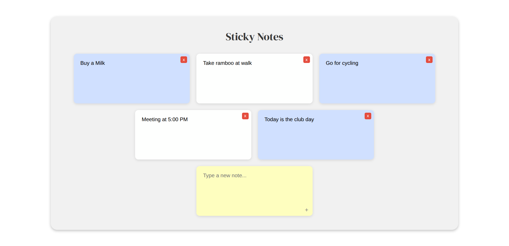

# Sticky Notes

A simple sticky notes app built with HTML, CSS and JavaScript. Type a note, click **+**, and it appears on the board. Click the **x** on any note to remove it.

**[Live Demo](https://blacysins.github.io/Sticky-Notes/)**



## Features

- Add notes with the **+** button
- Delete any note with the **x** button in its corner
- Notes alternate between two background colors
- Empty notes are blocked, and the textarea placeholder shows a message asking for some text
- Notes have a fixed size and wrap into rows; long text scrolls inside the note
- Clean layout with a soft shadow, rounded corners and the DM Serif Display heading font

## Built With

- HTML
- CSS (Flexbox, `position`, `:nth-child`, transitions)
- JavaScript (DOM manipulation, event listeners, event delegation)

## Run Locally

No build step or dependencies are needed.

1. Clone the repository:

```
git clone https://github.com/blacysins/Sticky-Notes.git
```

2. Open the project folder.
3. Open `index.html` in your browser.

## Project Structure

```
.
├── index.html
├── style.css
├── script.js
└── screenshot.png
```

## What I Learned

- Creating and appending elements with `document.createElement()`
- Handling clicks on dynamically created elements with event delegation
- Positioning elements with `position: relative` and `absolute`
- Alternating styles with `:nth-child(even)`
- Building a layout that grows with its content using Flexbox

## Credits

This project is based on the [Sticky Notes project](https://bigbinaryacademy.com/sticky-notes-project) from the JavaScript course at BigBinary Academy.

---
